<div align="center">

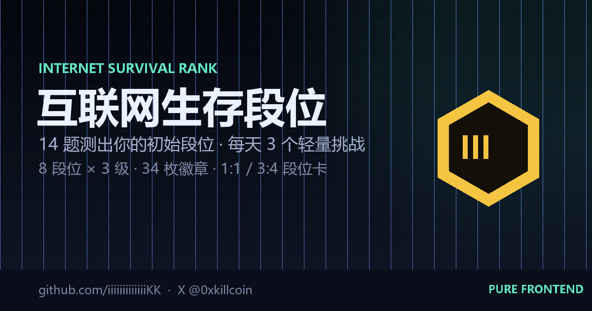

# 互联网生存段位 · Internet Survival Rank

**14 道情景题测出你的初始段位，每天 3 个轻量挑战决定你能爬多高。**

复古街机 × 像素风 · 纯前端 · 无账号 · 无后端 · 数据只存在你自己的浏览器里

[](https://321.market/internet-survival-rank/)
[](https://x.com/0xkillcoin)

[](#-技术栈)
[](#-技术栈)
[](#-技术栈)
[](#-测试与验收)
[](LICENSE)

[**在线试玩**](https://321.market/internet-survival-rank/) · [玩法](#-玩法) · [段位表](#-八段位--三级24-级) · [本地运行](#-本地运行) · [测试报告](TEST_REPORT.md) · [作者 𝕏](https://x.com/0xkillcoin)

</div>

---

> [!NOTE]
> **这是娱乐玩法，不是真实能力评估。** 段位与徽章只反映你在本游戏里的选择，不代表你的智力、人格、媒介素养或任何真实能力。本站不收集真实姓名、手机号、通讯录、定位等任何非必要信息。

---

## 📸 截图

<table>
<tr>
<td width="50%">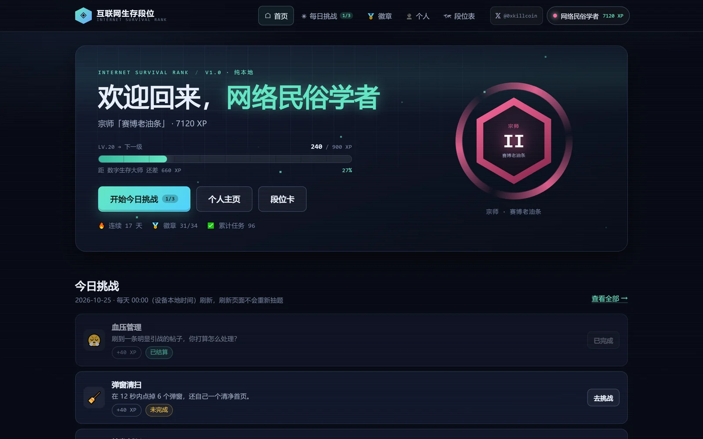<br /><sub><b>首页</b>：当前段位 + 开始挑战</sub></td>
<td width="50%">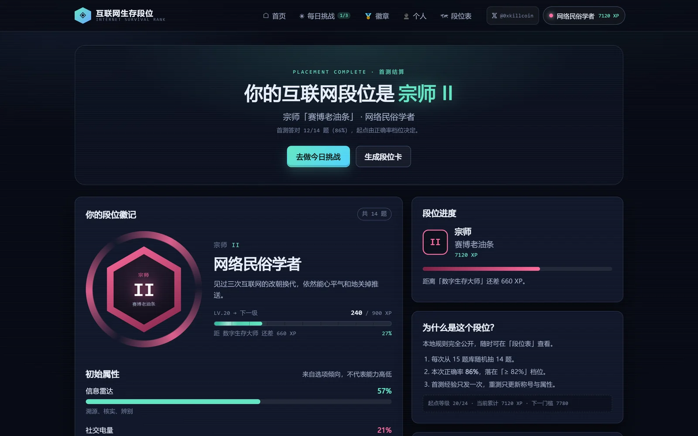<br /><sub><b>首测结果</b>：段位徽记 + 三维属性</sub></td>
</tr>
<tr>
<td width="50%">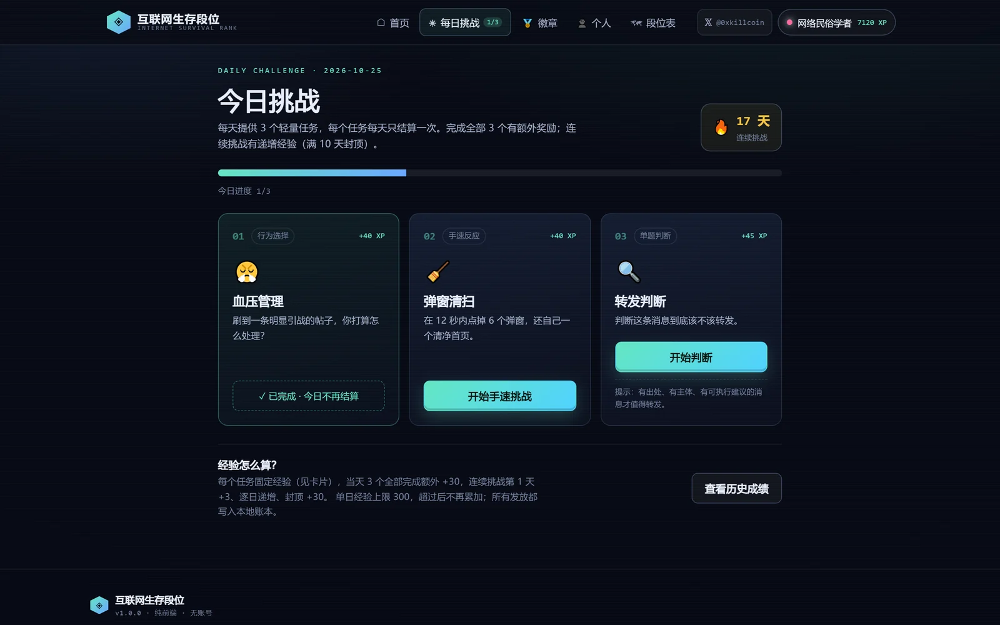<br /><sub><b>每日挑战</b>：3 个轻量任务，每天只结算一次</sub></td>
<td width="50%">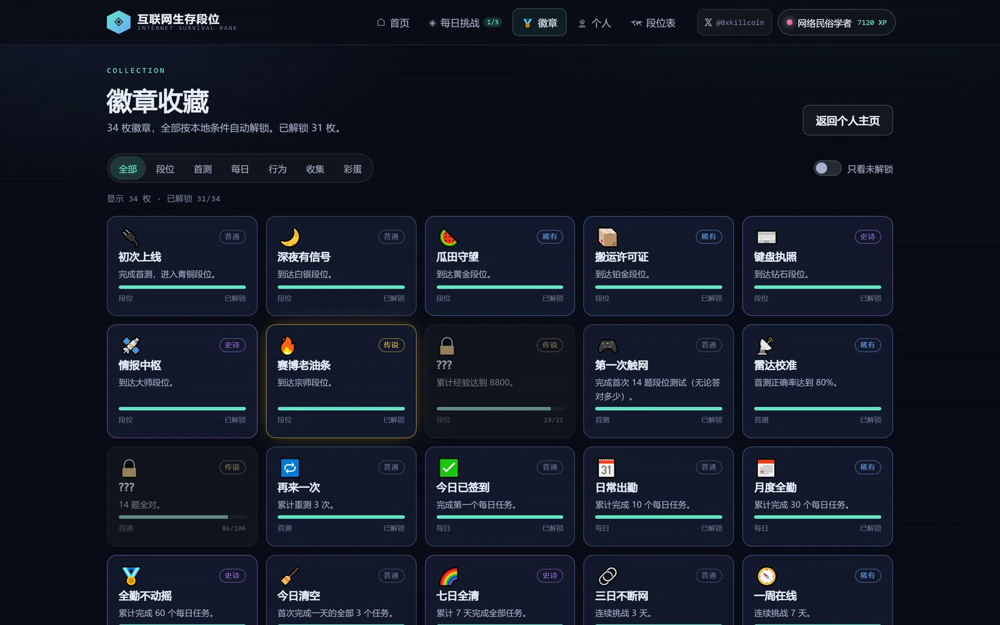<br /><sub><b>徽章</b>：34 枚，按本地条件自动解锁</sub></td>
</tr>
<tr>
<td width="50%">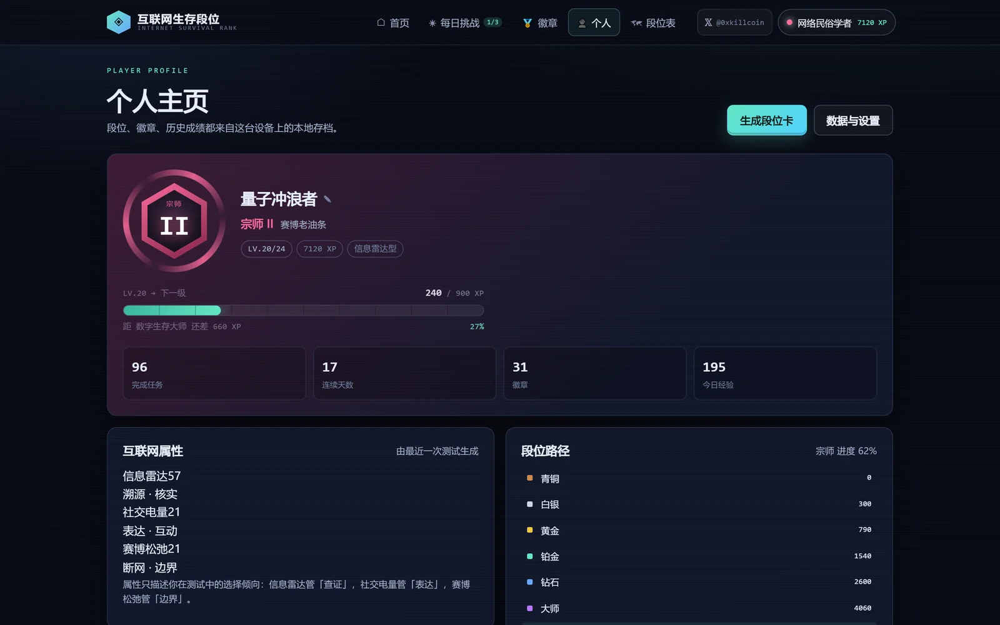<br /><sub><b>个人主页</b>：等级、属性、历史成绩</sub></td>
<td width="50%">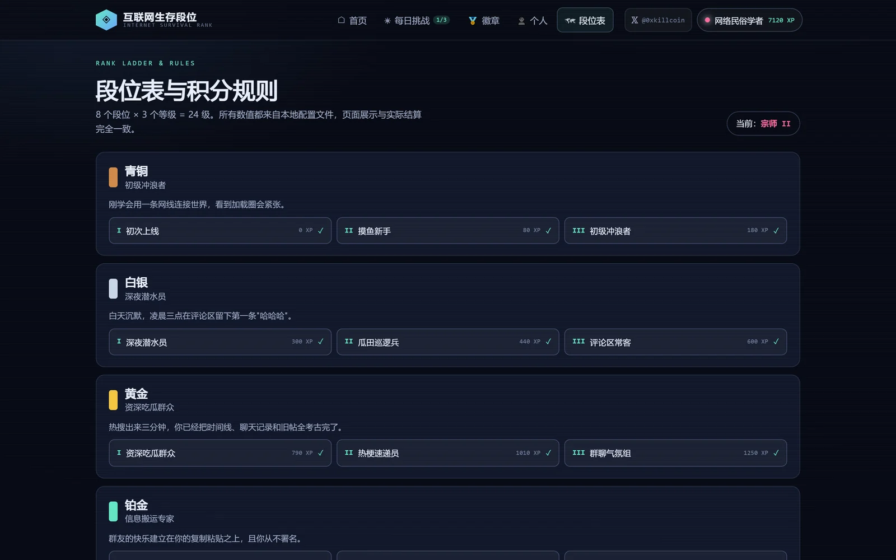<br /><sub><b>段位表</b>：24 级门槛与积分规则全公开</sub></td>
</tr>
<tr>
<td width="50%">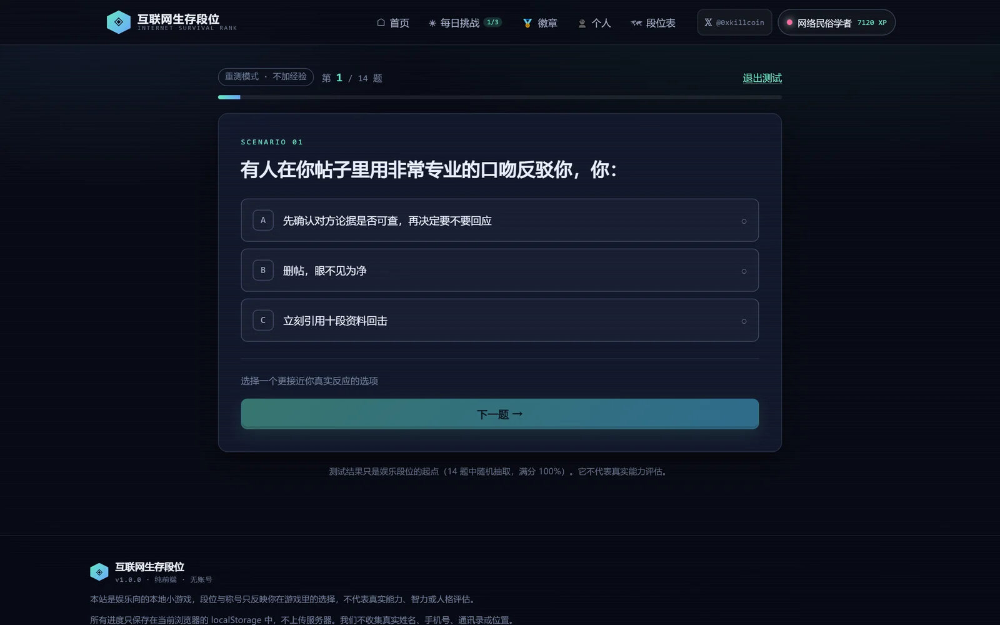<br /><sub><b>首测</b>：15 题库随机抽 14 题</sub></td>
<td width="50%">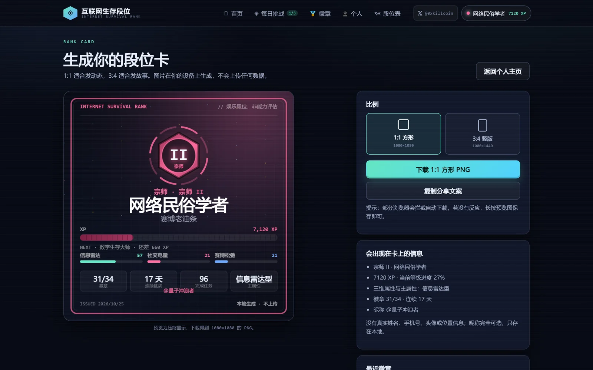<br /><sub><b>段位卡</b>：Canvas 现场绘制，可下载 PNG</sub></td>
</tr>
</table>

### 分享卡（真实导出产物）

<div align="center">
<table>
<tr>
<td width="46%">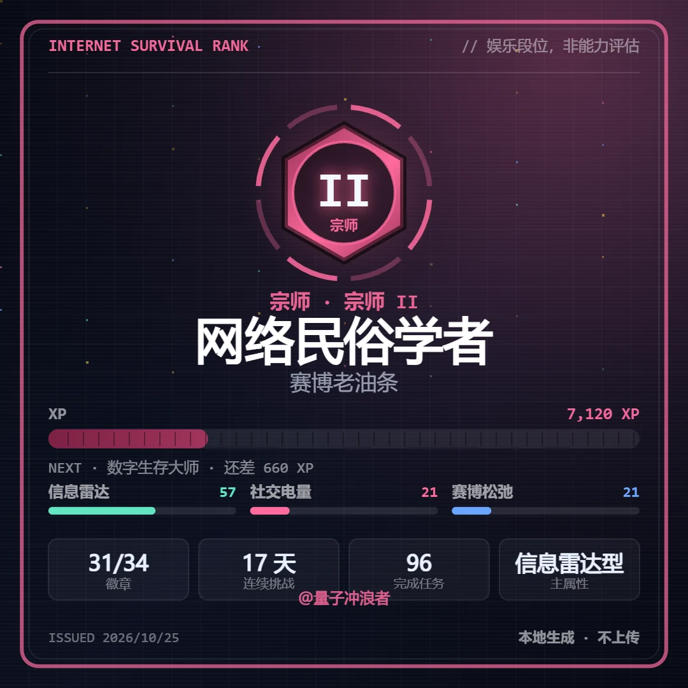<br /><sub><b>1:1 · 1080×1080</b></sub></td>
<td width="38%">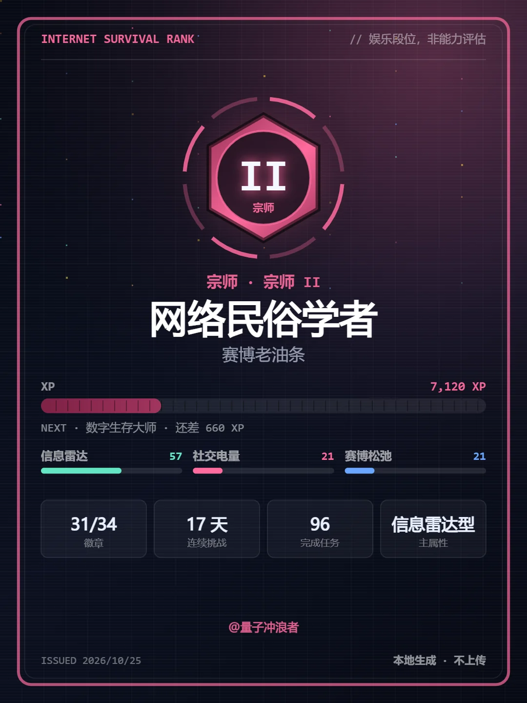<br /><sub><b>3:4 · 1080×1440</b></sub></td>
</tr>
</table>
</div>

### 移动端

<div align="center">
<table>
<tr>
<td width="30%">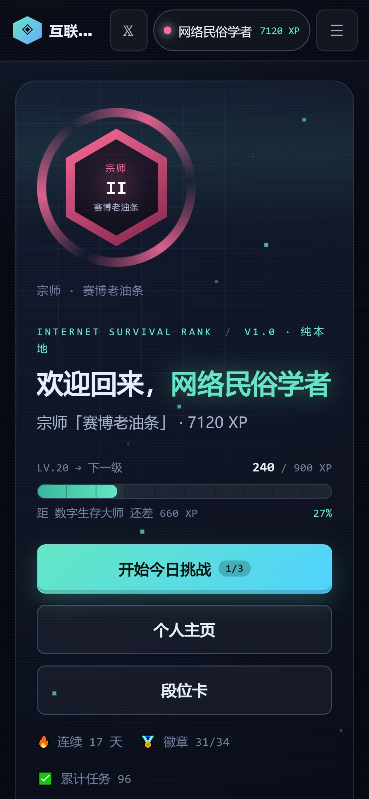<br /><sub>首页</sub></td>
<td width="30%">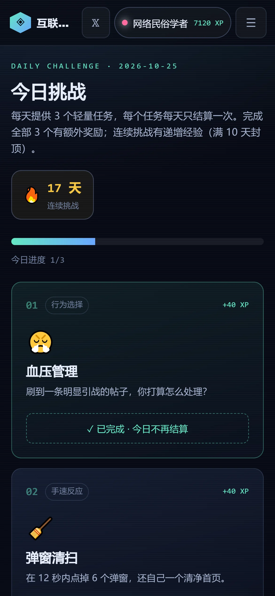<br /><sub>每日挑战</sub></td>
<td width="30%">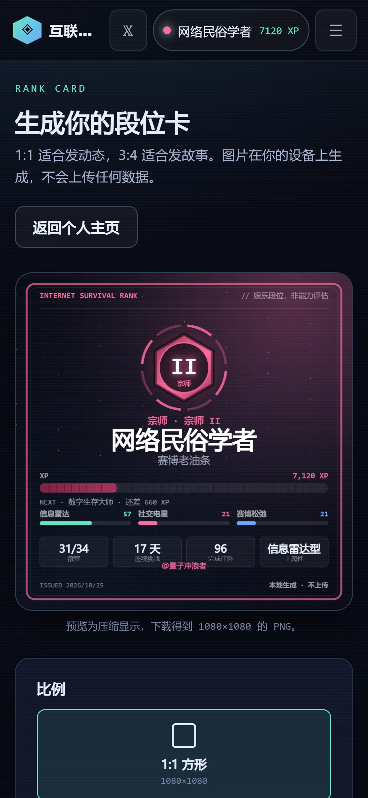<br /><sub>段位卡</sub></td>
</tr>
</table>
</div>

---

## ✨ 亮点

| | 特性 | 说明 |
|---|---|---|
| 🎯 | **可解释的积分系统** | 每一点经验都能追溯到「哪条规则、哪个任务、哪一天」，写入本地账本 |
| 🛡️ | **真的防重复领奖** | 刷新、连点、双击、改系统时间、跨时区，都拿不到第二次奖励 |
| 📦 | **版本化存档 + 自愈** | schema v3、FNV-1a 校验和、v1→v2→v3 迁移、备份恢复、损坏安全模式 |
| 🎨 | **零依赖美术** | 所有徽记、扫描线、像素粒子都是 CSS / Canvas 手写，未使用任何现有游戏资产 |
| 📱 | **触控优先** | iPhone SE 到 Pro Max、iPad、桌面 1920 全部实测无横向溢出，触控目标 ≥44px |
| ♿ | **尊重减少动画** | 系统级 `prefers-reduced-motion` 与站内开关都会关闭粒子/闪烁/过渡 |
| 🔒 | **零网络请求** | 没有任何 fetch/XHR/埋点/第三方脚本，E2E 断言外部请求数为 0 |
| 🧪 | **256 项自动化测试** | 156 项纯逻辑自测 + 100 项浏览器 E2E + 72 组合响应式审计 |

---

## 🕹 玩法

### 三步上手

```
① 首测          ② 每日挑战             ③ 爬段位 · 收徽章 · 出卡
14 道情景题  →   每天 3 个轻量任务   →  经验跨门槛升级 / 解锁徽章
定初始段位      每个只结算一次          导出 1:1 / 3:4 段位卡
```

### 首测（决定起点）

- 题库 **15 题**，每次**随机抽 14 题**并打乱选项顺序（`src/config/quiz.ts`）
- 三个维度：**信息雷达**（溯源核实）/ **社交电量**（表达互动）/ **赛博松弛**（断网边界）
- 正确率决定初始等级，档位完全公开（`PLACEMENT_BANDS`）：

| 正确率 | ≥0% | ≥14% | ≥28% | ≥40% | ≥50% | ≥60% | ≥68% | ≥76% | ≥82% | ≥88% | ≥92% | ≥95% | ≥97% | ≥99% |
|---|---|---|---|---|---|---|---|---|---|---|---|---|---|---|
| 起点 | 青铜 I | 青铜 II | 青铜 III | 白银 I | 白银 II | 白银 III | 黄金 I | 黄金 II | 黄金 III | 铂金 I | 铂金 II | 铂金 III | 钻石 I | 钻石 II |

> 首测最高只能到 **钻石 II**，剩下的段位要靠每日挑战慢慢爬。重测只更新称号与属性，**不会重复发放经验**。

### 每日挑战（决定升级）

每天（设备本地时间 00:00 后）生成 **3 个不同类型**的轻量任务：

| 类型 | 玩法 | 示例 |
|---|---|---|
| 🎭 **行为选择** | 3 选 1，记录你的行为倾向 | 「刷到引战帖，你怎么处理？」 |
| 🔍 **单题判断** | 判断消息该不该转发 | 「内部消息：明天起所有 App 都要收费」 |
| ⚡ **手速反应** | 限时点掉弹窗 | 12 秒内点掉 6 个弹窗 |
| 🌿 **离线计时** | 20 秒离开信息流 | 「把视线移到窗外」 |

任务由「日期 + 安装盐」作随机种子，**同一天刷新页面不会重新抽题**。

### 经验规则（全公开）

```text
单个任务          30 ~ 45 XP（见 src/config/daily.ts）
当天 3 个全清     +30 XP
连续挑战第 n 天   +3n XP（封顶 +30）
─────────────────────────────
单日经验上限      300 XP
单日理论最大值    45×3 + 30 + 30 = 195 XP
首测经验          起点门槛 + 正确率奖励（至少 10 点参与奖励，且不跨级）
```

---

## 🏆 八段位 × 三级（24 级）

| 段位 | 段位称号 | I | II | III | 起始经验 |
|:---:|---|---|---|---|---:|
| 🟤 **青铜** | 初级冲浪者 | 初次上线 | 摸鱼新手 | 初级冲浪者 | 0 |
| ⚪ **白银** | 深夜潜水员 | 深夜潜水员 | 瓜田巡逻兵 | 评论区常客 | 300 |
| 🟡 **黄金** | 资深吃瓜群众 | 资深吃瓜群众 | 热梗速递员 | 群聊气氛组 | 790 |
| 🟢 **铂金** | 信息搬运专家 | 信息搬运专家 | 表情包管理员 | 热搜导航仪 | 1540 |
| 🔵 **钻石** | 键盘战略家 | 键盘战略家 | 长文折叠师 | 赛博考古学家 | 2600 |
| 🟣 **大师** | 互联网情报员 | 互联网情报员 | 舆情雷达站 | 流量解码器 | 4060 |
| 🔴 **宗师** | 赛博老油条 | 赛博老油条 | 网络民俗学者 | 数字生存大师 | 6060 |
| 👻 **隐藏** | 互联网幽灵 | 互联网幽灵 | 无名观测者 | 离线传说 | 8800 |

> 最后一段位在未达成前显示为 `???`。它的解锁条件与「在线时长」无关，与你在游戏里持续做出的选择有关。

---

## 🏅 34 枚徽章

| 分类 | 数量 | 例子 |
|---|---:|---|
| 段位 | 8 | 初次上线 · 瓜田守望 · 键盘执照 · 查无此人 |
| 首测 | 4 | 第一次触网 · 雷达校准 · 一次都没被骗 · 再来一次 |
| 每日 | 9 | 今日已签到 · 月度全勤 · 七日全清 · 两周不塌房 |
| 行为 | 7 | 血压稳定 · 已读不回 · 转发守门员 · 凌晨三点观察员 |
| 收集 | 4 | 方形名片 · 竖版海报 · 搬家成功 · 段位研究员 |
| 彩蛋 | 2 | 数据外科医生（从损坏里恢复）· 重新做人（主动重置） |

每枚徽章只声明「指标 + 阈值」，由引擎统一评估 —— 条件可解释、可测试、可复现：

```ts
{ id: 'streak-14', name: '两周不塌房', metric: 'bestStreak', gte: 14, rarity: 'legend', … }
```

---

## 🧠 技术设计

### 架构

```
internet-survival-rank/
├─ src/
│  ├─ config/            ← 所有可调数值（改游戏只改这里）
│  │  ├─ tiers.ts          8 段位 × 3 级、门槛、称号、首测档位
│  │  ├─ quiz.ts           15 道题库 + 三个属性维度
│  │  ├─ daily.ts          每日任务模板 + 判断题库
│  │  ├─ economy.ts        经验公式、单日上限、首测奖励
│  │  ├─ badges.ts         34 枚徽章（指标 + 阈值）
│  │  └─ site.ts           文案、免责声明、未上线能力声明
│  ├─ lib/               ← 纯函数核心（零副作用，可在 Node 里直接测）
│  │  ├─ storage.ts        版本化存档、校验和、迁移、备份恢复、导入导出
│  │  ├─ game.ts           评分 / 结算 / 防重 / 徽章 / 进度
│  │  ├─ card.ts           Canvas 2D 段位卡绘制
│  │  └─ testable.ts       测试统一出口
│  ├─ hooks/useGameStore.ts 存档读写、节流落盘、跨标签页同步、跨天刷新
│  ├─ pages/             ← 首页 / 首测 / 结果 / 每日 / 徽章 / 个人 / 卡片 / 设置 / 段位表
│  ├─ components/        ← 顶栏、页脚、Toast、弹窗、经验条、徽记、属性条
│  └─ styles/global.css  ← 手写 CSS（约 3.9k 行），像素/CRT 视觉
└─ scripts/              ← 测试与截图工具
```

### 四个关键决策

<table>
<tr><td width="4%">1</td><td width="20%"><b>单一数据源</b></td><td>段位门槛、任务经验、徽章阈值只在 <code>src/config/*</code> 定义一次；UI 展示、结算逻辑、测试断言读取同一份常量，不可能出现「页面写的和实际算的不一致」。</td></tr>
<tr><td>2</td><td><b>纯函数引擎</b></td><td><code>src/lib/game.ts</code> 不做副作用、不碰存储，输入输出都是普通对象。因此跨天、时区倒退、连点、上限这些边界可以在 Node 里直接断言，不需要启动浏览器。</td></tr>
<tr><td>3</td><td><b>账本式经验</b></td><td>任何加分都必须写入一条带唯一 id 的账本（<code>placement</code> / <code>task:日期:任务</code> / <code>clear:日期</code> / <code>streak:日期</code>）。重复 id 直接拒绝；读取时若 <code>xp</code> 大于账本总和，判为篡改并按账本回退。</td></tr>
<tr><td>4</td><td><b>不假装有后端</b></td><td>账号同步、公开排行榜、好友挑战只以「未上线」形式出现在 UI 和类型声明里，没有任何假接口调用。页面零 fetch / 零埋点。</td></tr>
</table>

### 技术栈

`React 18` · `TypeScript 5.6（strict）` · `Vite 5` · 手写 CSS · `Canvas 2D` · `localStorage`
无 UI 框架、无状态管理库、无 CSS 框架、无第三方截图库、无后端。

---

## 🔐 防刷与容错

| 场景 | 处理方式 | 验证 |
|---|---|---|
| 同一任务重复点击 / 双击确认 | `done` 列表 + 账本 id 双重校验 | 连点 20 次只成功 1 次 |
| 刷新页面重复领奖 | 完成状态与账本一起落盘，按钮禁用 | E2E 刷新后经验不变 |
| 改系统时间 / 换时区 | 日期按本地日历算；回到已完成的那天会复用原记录 | 单测「时间倒退」用例 |
| 跨天重复领取昨天任务 | 任务 id 含日期，旧任务无法再提交 | 单测跨天 + 断签用例 |
| 单日狂刷 | 单日上限 300 XP | 预算到 295 后只发剩余 5 点 |
| 手改 localStorage 抬高经验 | 校验和不匹配 → 备份恢复；伪造校验和 → 按账本回退 | E2E 把 xp 改成 999999，刷新后回到真实值 |
| 反复重测刷经验 | 首测只发一次，重测仅更新属性 | E2E 重测后 xp 不变 |
| 导入被篡改的进度文件 | 校验和 / 结构 / 版本三重校验，拒绝并说明原因 | 单测 4 种非法输入 |

### 存档读取顺序

```text
主档 JSON  ──成功──▶ 校验和比对 ──成功──▶ 版本迁移 ──▶ 徽章评估 ──▶ 正常使用
   │                     │
   │                     └─失败─▶ 经验账本对账（xp > 账本总和则回退）
   ▼
备份 .bak ──成功──▶ 从备份恢复（坏档另存 .corrupt）
   │
   ▼
宽松修复 ──成功──▶ 补齐字段 / 裁剪非法值 / 标记 repaired
   │
   ▼
安全模式 ──▶ 全新存档 + 顶部提示「可下载原始数据」+ 引导重置
```

---

## 🚀 本地运行

```bash
# 需要 Node.js ≥ 18
npm install
npm run dev        # http://127.0.0.1:5190/
```

| 命令 | 作用 |
|---|---|
| `npm run dev` | 开发模式（HMR，端口 5190） |
| `npm run build` | 类型检查 + 打包到 `dist/` |
| `npm run preview` | 本地预览构建产物（端口 4190） |
| `npm test` | 规则层自测（156 项，纯 Node） |
| `npm run test:e2e` | 浏览器验收（100 项，需先 build） |
| `npm run test:layout` | 响应式审计（9 视口 × 8 页面） |
| `npm run test:device` | iPhone 设备参数模拟（4 机型 × 8 页面） |
| `npm run test:all` | 构建 + 全部测试 |

> Windows PowerShell 若提示「禁止运行脚本」，把 `npm` 换成 `npm.cmd`。

---

## 🌐 部署

产物是纯静态文件，`base: './'` + hash 路由，可直接放在任意子路径。

<details open>
<summary><b>GitHub Pages（已配置）</b></summary>

仓库内置 `.github/workflows/deploy.yml`：push 到 `main` 后自动 **类型检查 → 规则自测 → 构建 → 发布 Pages**。

线上地址：**https://321.market/internet-survival-rank/**（GitHub Pages，已绑定自定义域名 321.market；`iiiiiiiiiiiiiKK.github.io/internet-survival-rank` 会 301 跳转到这里）

手动触发：仓库 → Actions → `Deploy to GitHub Pages` → Run workflow。
</details>

<details>
<summary><b>Vercel</b></summary>

```bash
npm i -g vercel
vercel --prod
```

或导入仓库，框架预设选 **Vite**，构建命令 `npm run build`，输出目录 `dist`。
</details>

<details>
<summary><b>Cloudflare Pages</b></summary>

构建命令 `npm run build`，输出目录 `dist`，无需环境变量。
或直接上传 `dist/` 到 Cloudflare Pages / R2 / 任意对象存储。
</details>

<details>
<summary><b>Nginx</b></summary>

```nginx
server {
  listen 80;
  server_name example.com;
  root /var/www/internet-survival-rank/dist;
  index index.html;
  location / { try_files $uri $uri/ /index.html; }
}
```
</details>

> **提示**：localStorage 按「协议 + 域名 + 端口」隔离。换域名后旧进度不可见，可在「数据与设置」里导出再导入。

---

## 🧪 测试与验收

<details open>
<summary><b>最近一次完整运行结果</b></summary>

```text
npm run build       ✅ tsc strict 通过，Vite 构建成功
npm test            ✅ 156 项通过，0 失败（规则层）
npm run test:e2e    ✅ 100 项通过，0 失败（桌面 1440×900 + 手机 390×844）
npm run test:layout ✅ 72 个「视口 × 页面」组合，0 个问题
npm run test:device ✅ iPhone SE / 13 mini / 15 / 15 Pro Max 全部通过
```

</details>

<details>
<summary><b>覆盖的验收项</b></summary>

- ✅ 首次测试生成段位（14 题随机抽、自动跳结果页、写盘）
- ✅ 经验正确增加；跨门槛升级；重测不重复加分
- ✅ 徽章按条件解锁（首测 / 分享 / 导入 / 全清 / 连续天数）
- ✅ 每日任务不重复领奖（刷新、双击、按钮禁用）
- ✅ 刷新后进度仍在
- ✅ 重置与数据损坏恢复有效
- ✅ 分享卡正确导出（真实 PNG，IHDR 校验 1080×1080 / 1080×1440）
- ✅ 手机端布局正常（iPhone 六种尺寸 + 320px 极限宽度）

完整用例与修复记录见 👉 [**TEST_REPORT.md**](TEST_REPORT.md)

</details>

---

## 🔒 隐私

- **不收集**真实姓名、手机号、邮箱、通讯录、定位、设备标识或任何账号信息
- **零网络请求**：没有埋点、没有第三方脚本、没有 CDN 字体（使用系统字体回退）
- 可选昵称（≤12 字符）只存本地，仅用于段位卡展示，可随时清空
- 所有数据可一键导出 JSON、一键重置（重置需输入「重置」二次确认）
- 仓库中不含任何密钥、令牌或个人数据

---

## 🗺 Roadmap

- [ ] 账号同步（跨设备保存进度）
- [ ] 公开排行榜（需服务端校验，避免纯前端伪造）
- [ ] 好友挑战（同一道每日任务对答案）
- [ ] 更多任务类型（记忆翻牌、错别字猎手）
- [ ] 段位卡模板主题（青铜纹 / 霓虹 / 终端绿）

> 前三项在 UI 中已标注为「未上线」，只预留了类型声明，没有任何假接口调用。

---

## 🤝 贡献

欢迎 Issue / PR。提交前请确保：

```bash
npm run typecheck && npm test && npm run build && npm run test:e2e
```

新玩法请只改 `src/config/*`，新规则请补 `src/lib/game.ts` 的纯函数并在 `scripts/selftest.mjs` 加断言。

---

## 📄 License

[MIT](LICENSE) © 2026 [@0xkillcoin](https://x.com/0xkillcoin)

段位名称、文案与像素徽记均为原创，未使用任何现有游戏的专有视觉资产。

<div align="center">
<br />

**如果你也想知道自己能在互联网活到第几段 ——**

[](https://321.market/internet-survival-rank/)
[](https://x.com/0xkillcoin)

<sub>本站是娱乐向的本地小游戏，段位与称号不构成任何真实能力评估。</sub>

</div>
